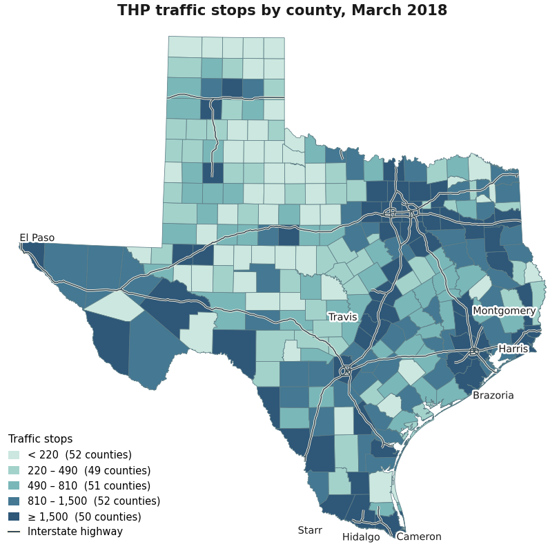
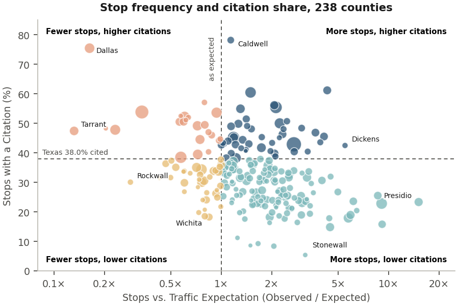

# DPS THP Traffic Stops, March 2018

County distribution of Texas Highway Patrol stops, with an interactive dashboard and a [PDF report](docs/report.pdf).

**271,242 stops · 254 counties · 30,107 inspections · 37 counties account for half of all stops.**




## Open the dashboard

```sh
python3 -m http.server 8000 --directory docs
```

Open http://localhost:8000. The dashboard includes all generated county values and map geometry. It runs without a database, Python packages or external scripts. D3 is bundled with its [license](docs/assets/d3.LICENSE).

## Publish

Upload the ZIP contents, including `.github`, to the root of a public GitHub repository on `main` or `master`. In **Settings → Pages → Source**, select **GitHub Actions** once. The included workflow publishes `docs/` on each push. If the first run preceded that setting, rerun **Publish dashboard** under Actions. The workflow displays the site URL. See [GitHub Pages setup](https://docs.github.com/en/pages/getting-started-with-github-pages/using-custom-workflows-with-github-pages).

## Rebuild the analysis

Requires Python 3.10 through 3.13 and the downloads listed in [data/README.md](data/README.md). Put those files in `data/`, then run:

```sh
python3 -m venv .venv
.venv/bin/python -m pip install -r requirements.txt
.venv/bin/python pipeline/run_all.py
```

On Windows, use `python` and `.venv\Scripts\python.exe`.

The five stages prepare county references, build the DuckDB database, calculate county measures, draw figures and generate tables. Results go to `outputs/`, `docs/data/` and `report/`. The public package contains the compiled PDF; its LaTeX manuscript is not included. With the manuscript available, add `--report` to compile it using `pdflatex` and `bibtex`.

Stops are reconstructed from tickets sharing trooper, recorded minute, county, driver and vehicle attributes. Counts include inspections. Population and traffic rates, citation shares and search outcomes use enforcement stops. The PDF documents definitions, statistical methods and quality checks.

Independent analysis of public data. Not an official Texas DPS Report. ChatGPT, Codex and Claude Code assisted with planning, implementation and report preparation under the author's direction.
